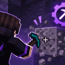

# GovernixMiner



**Client-side Fabric mod for Minecraft 1.21.8.** GovernixMiner automatically holds the normal attack input while your crosshair is pointed at a block, so you can leave the view aimed at a block and read manga instead of physically holding the mouse button.

## How it works

1. Join a world and point your crosshair at the block you want to mine.
2. Press **G** to enable or disable auto-mining.
3. While enabled, the mod holds Minecraft's standard attack key only while the crosshair targets a non-air block.
4. When the block breaks and the next block becomes the crosshair target, normal mining continues automatically.

The mod does not aim or turn the camera. Keep the crosshair on the block/line you want to mine.

## Controls

| Key | Action |
|---|---|
| `G` | Toggle auto-mining |

The key can be rebound in **Options → Controls → Key Binds → GovernixMiner**.

Opening an in-game screen or losing the block target releases the attack key. Disconnecting from a world disables the mode.

## Requirements

- Minecraft Java Edition **1.21.8**
- Fabric Loader
- Fabric API for 1.21.8
- Java 21

## Build

Run from this directory:

```bash
gradle --no-daemon clean build
```

The remapped mod JAR is written to `build/libs/`.

## Important

GovernixMiner uses the ordinary client attack-key path. It does not send custom packets, increase reach, speed up the block-breaking timer, or bypass server validation. Mining speed, tool requirements and server-side rules remain unchanged.

Some multiplayer servers prohibit automated holding/clicking of attack. Check the server rules before using the mod there.
